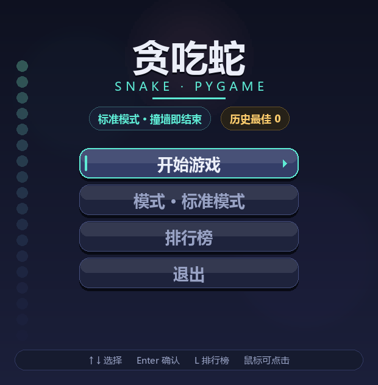
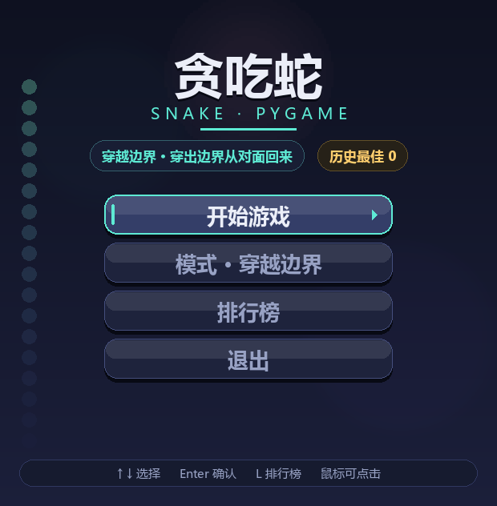
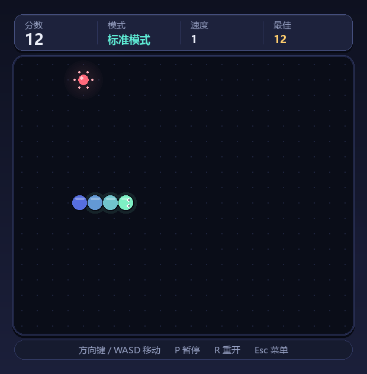
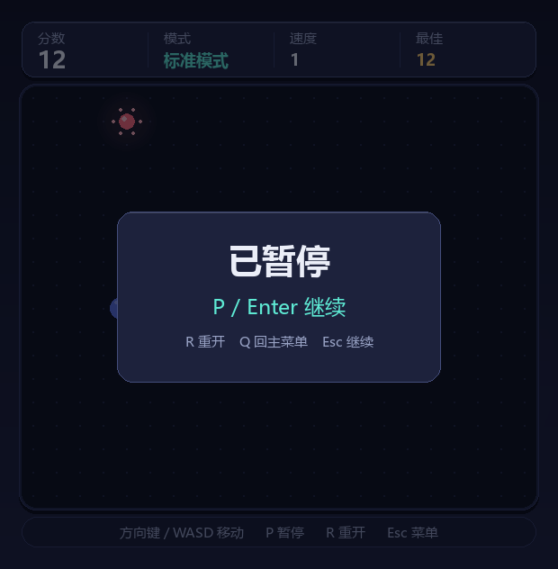
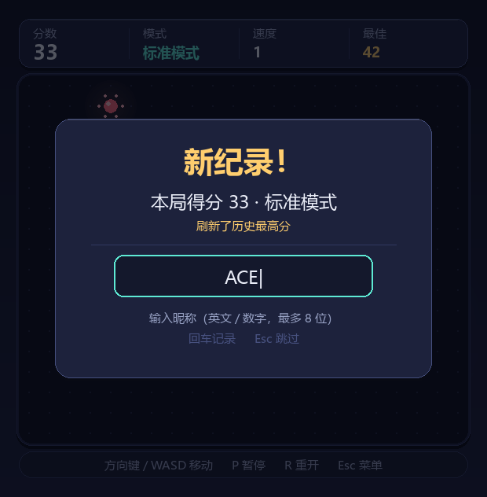
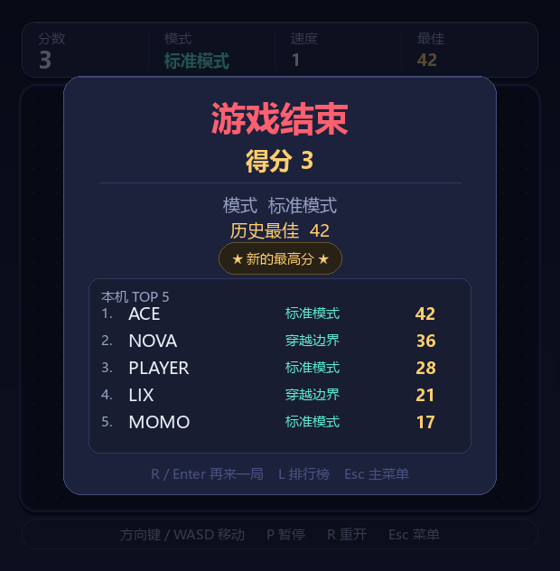

# 贪吃蛇 · Snake (pygame)

一个用 **Python + pygame** 从零写的桌面贪吃蛇，模块化目录结构、深色主题 UI、平滑插值移动、粒子特效、本地排行榜持久化，并支持**无控制台窗口**双击启动。

支持两种玩法模式、完整状态机（菜单 → 游戏 → 暂停 → 昵称录入 → 结算 → 排行榜），并自带无界面冒烟测试与截图渲染脚本。



---

## 目录

- [界面预览](#界面预览)
- [功能特性](#功能特性)
- [环境要求](#环境要求)
- [技术栈与第三方库](#技术栈与第三方库)
- [安装](#安装)
- [运行](#运行)
- [操作说明](#操作说明)
- [项目结构](#项目结构)
- [实现步骤](#实现步骤)
- [核心实现细节](#核心实现细节)
- [自测](#自测)
- [数据存储](#数据存储)
- [常见问题](#常见问题)
- [许可证](#许可证)

---

## 界面预览

| 菜单（标准模式） | 菜单（穿越边界） | 游戏中 |
| --- | --- | --- |
|  |  |  |

| 暂停 | 排行榜 | 昵称录入 | 结算 |
| --- | --- | --- | --- |
|  |  |  |  |

> 截图由 `shots.py` 以 SDL dummy 驱动离屏渲染生成，不依赖显示器，可随时 `python shots.py` 重出。

---

## 功能特性

### 玩法

- **两种模式，菜单内随时切换，无需重启**
  - **标准模式**：撞墙即结束
  - **穿越边界**：从一侧穿出、另一侧钻回，只有撞到自己才结束
- **逐级加速**：初始 150 ms/步，每吃一个食物提速 4 ms，下限 70 ms/步
- **追尾合法**：非增长帧尾巴会同时移走，碰撞判定排除尾节，不会出现"明明能活却判死"
- **转向队列**：按键只入队，每帧消费一个并拒绝同帧掉头，杜绝"一帧按两次原地自杀"
- **通关判定**：棋盘被蛇填满、无法生成食物时判定通关（`win`）

### 界面

- **平滑移动**：每帧在上一帧与当前帧坐标之间线性插值，蛇在两格之间连续滑动
- **渐变蛇身**：头到尾颜色渐变 + 每节顶部高光，头部有方向性蛇眼与光晕
- **食物特效**：辉光呼吸、绕行点缀、吃到时粒子爆开 + `+1` 飘字
- **HUD 信息条**：实时显示分数 / 模式 / 速度等级 / 历史最佳
- **独立底部提示条**：棋盘与操作提示物理分离，蛇和背景装饰**永远不会遮挡**提示文字
- **装饰蛇**：菜单背景沿棋盘边框游动的半透明蛇，只在棋盘区域内活动
- **自适应文字**：所有表格列按固定宽度截断并补省略号，长昵称 / 异常数据也不越界

### 排行榜

- 本地 `JSON` 持久化，只保留 **TOP 10**
- 按分数降序；同分按提交时间靠前
- 保存昵称、分数、模式、时间
- **新纪录判定**：只有分数**超过本局开始前的历史最高**才算新纪录（并列最高不算），与"能不能进榜"无关
- 提交后回到排行榜，本局记录整行呼吸高亮
- 结算页内嵌 TOP 5 小榜，列宽固定左对齐

### 工程化

- **模块拆分**：逻辑（`game.py`）不依赖 pygame，可脱离界面单独测试
- **无控制台启动**：`run.vbs` / `run.bat` 走 `pythonw.exe`，双击只出游戏窗口
- **崩溃兜底**：无 stderr 时把异常写入 `error.log` 并弹系统提示框，不会"点了没反应"
- **无瑕自测**：`smoke_test.py` 用 SDL dummy 驱动跑通全部状态与两种模式
- **截图脚本**：`shots.py` 离屏渲染 7 张界面图

---

## 环境要求

| 项目 | 版本 / 说明 |
| --- | --- |
| 操作系统 | Windows 10 / 11（已在 Windows 10 1909 实测；代码未使用 Windows 专有 API 之外的东西，理论上 Linux/macOS 可跑，但字体与启动脚本按 Windows 写的） |
| Python | **3.12**（`3.12.14` 实测）。3.10+ 语法上可用（用了 `from __future__ import annotations` 与 `Optional` 风格的类型标注） |
| pygame | **2.6.1**（内置 SDL 2.28.4） |
| 显示 | 需要图形界面；自测/截图脚本用 `SDL_VIDEODRIVER=dummy` 可无头运行 |
| 中文字体 | 优先使用系统字体（微软雅黑 / 黑体 / 等线 / 微软正黑 / Noto Sans CJK），找不到会回退 pygame 默认字体（**此时中文会显示为方块**） |

窗口尺寸由常量推导：`22 列 × 18 行 × 26 px` 棋盘 + HUD + 底部提示条 = **620 × 632**。

---

## 技术栈与第三方库

### 技术栈

- **语言**：Python 3.12（纯 Python，无编译步骤、无 C 扩展需自行构建）
- **图形 / 输入 / 计时**：pygame（建立在 SDL 2 之上）
- **架构**：状态机（字符串常量 `MENU / BOARD / PLAY / ENTRY / OVER`）
- **渲染**：即时模式（immediate mode）逐帧重绘，`Surface` 叠加 + `pygame.display.flip()`
- **持久化**：单个 JSON 文件
- **测试**：自写断言脚本 + SDL dummy 视频驱动（无 pytest 依赖）

### 第三方库

**只有一个运行时依赖：**

```text
pygame>=2.5      # requirements.txt
```

- **pygame 2.6.1** —— 提供窗口、2D 绘制（矩形 / 圆 / 线 / 多边形）、字体渲染、`Surface` 与 `SRCALPHA` 透明混合、`transform.scale_by` 缩放、事件循环、`Clock` 帧率控制、`image.save` 截图。
  未使用 `pygame.sprite`、`pygame.mixer` 等子系统，音频完全没用到。

**只用到标准库，无其他第三方包：**

| 模块 | 用途 |
| --- | --- |
| `enum` | `Direction`（方向向量）、`Mode`（两种模式 + 显示名） |
| `random` | 随机生成食物位置 |
| `json` | 排行榜读写 |
| `datetime` | 记录成绩时间戳 |
| `pathlib` | 路径处理（相对脚本定位数据文件） |
| `os` / `sys` | 环境变量、解释器与标准流判断 |
| `traceback` | 全局异常钩子格式化堆栈 |
| `math` | 插值、粒子角度、呼吸动画、三角/圆周分布 |
| `ctypes` | 无控制台时弹出 Windows 系统错误框（`user32.MessageBoxW`） |
| `urllib` / `zipfile` | 仅 `install_pygame.py` 使用：pip 不可用时手动下载并解压 wheel |

---

## 安装

### 方式一：创建虚拟环境（推荐）

仓库**不包含** `.venv`（已加入 `.gitignore`，体积大且平台相关），克隆后按一次即可：

```bash
cd snake-pygame

# 1. 创建虚拟环境
python -m venv .venv

# 2. 安装依赖
.venv\Scripts\python.exe -m pip install -r requirements.txt
```

装完后 `run.vbs` / `run.bat` 会自动使用 `.venv\Scripts\pythonw.exe`。

### 方式二：装到当前解释器

```bash
python -m pip install -r requirements.txt
python main.py
```

此时 `main.py` 会先用当前解释器的 pygame；找不到才回退到项目内 `.venv` 的 `site-packages`。

### 方式三：pip 不可用时的兜底

某些受限环境（沙箱、精简 Python）下 pip 会因临时目录受限而失败。`install_pygame.py` 直接按 `cp312-cp312-win_amd64` 从 PyPI（失败则走阿里云镜像）下载 wheel 并解压进 `.venv\Lib\site-packages`，全程不调用 pip 的临时目录逻辑：

```bash
.venv\Scripts\python.exe install_pygame.py
```

---

## 运行

### 双击启动（无控制台窗口）

| 文件 | 说明 |
| --- | --- |
| **`run.vbs`** | 推荐。`wscript` 以 `WindowStyle=0` 隐藏启动 `pythonw.exe`，**完全不会闪出黑框** |
| `run.bat` | 内部同样是 `start "" pythonw.exe`，同样无控制台；存在 `.venv` 用项目解释器，否则用 PATH 里的 `pythonw` |

二者都会自动 `cd` 到脚本所在目录，因此**可以从任意位置双击**。

### 命令行启动（带控制台，便于看报错）

```bash
cd snake-pygame
.venv\Scripts\python.exe main.py
```

### 出错时

无控制台时异常不会凭空消失：

1. 完整堆栈写入项目根目录 `error.log`
2. 同时弹出一个 Windows 系统提示框显示末尾 1200 字符

启动失败（缺 pygame / 版本不匹配）走同一条路径，提示信息告诉你该用哪个解释器。

---

## 操作说明

| 场景 | 按键 | 说明 |
| --- | --- | --- |
| 菜单 | `↑` `↓` / `W` `S` | 切换选中项 |
| 菜单 | `Enter` / `空格` / 鼠标左键 | 确认 |
| 菜单 | 选中「模式」项 | 在 标准模式 / 穿越边界 之间切换 |
| 菜单 | `L` | 直接打开排行榜 |
| 菜单 | `Esc` | 退出程序 |
| 游戏中 | `↑` `↓` `←` `→` / `W` `A` `S` `D` | 转向 |
| 游戏中 | `P` / `Esc` | 暂停 |
| 游戏中 | `R` | 立即重开 |
| 暂停中 | `P` / `Enter` / `Esc` | 继续 |
| 暂停中 | `R` | 重开 |
| 暂停中 | `Q` | 回主菜单 |
| 昵称录入 | 字母 / 数字（≤ 8 位）、`Backspace` | 编辑昵称 |
| 昵称录入 | `Enter` | 记录并进入排行榜 |
| 昵称录入 | `Esc` | 跳过记录，直接结算 |
| 结算 | `R` / `Enter` | 再来一局 |
| 结算 | `L` | 打开排行榜 |
| 结算 | `Esc` | 回主菜单 |
| 排行榜 | `Esc` / `Enter` / `L` / 鼠标点击任意处 | 返回菜单 |

> 昵称录入仅在**分数能进前十**时出现；0 分不入榜，直接进入结算。

---

## 项目结构

```text
snake-pygame/
├── main.py             # 入口 + 状态机 + 各屏绘制 + 特效 + 主循环（约 790 行）
├── game.py             # 纯游戏逻辑：Direction / Snake / Game，不导入 pygame（约 185 行）
├── settings.py         # 尺寸、配色、节奏常量、Mode 枚举、中文字体加载（约 123 行）
├── leaderboard.py      # TOP 10 排行榜读写与排序（约 84 行）
├── ui.py               # 绘制工具层：渐变、辉光、圆角面板、按钮、表格单元格（约 253 行）
├── smoke_test.py       # 无界面冒烟测试，SDL dummy 驱动（约 227 行）
├── shots.py            # 离屏渲染 screenshots/ 下 7 张界面图（约 90 行）
├── repro.py            # 崩溃复现脚本：排行榜进出全流程回归（约 70 行）
├── install_pygame.py   # pip 不可用时的 pygame 安装兜底（约 65 行）
├── requirements.txt    # pygame>=2.5
├── run.vbs             # 无控制台启动（推荐）
├── run.bat             # 无控制台启动（备选）
├── leaderboard.json    # 排行榜数据，首次上榜时自动创建
├── screenshots/        # 界面截图（由 shots.py 生成）
│   ├── 1-menu.png
│   ├── 2-menu-wrap.png
│   ├── 3-play.png
│   ├── 4-pause.png
│   ├── 5-leaderboard.png
│   ├── 6-entry.png
│   └── 7-over.png
└── .venv/              # 项目虚拟环境（建议不入库，见 .gitignore）
```

### 模块依赖关系

```text
main.py ──> game.py ──> settings.py
   │  │
   │  └──> leaderboard.py ──> settings.py
   │
   └──> ui.py ──> settings.py

settings.py ──> pygame   (仅字体/字体缓存)
game.py     ──> 纯标准库（enum / random / settings 常量）
```

**关键约束**：`game.py` 不导入 pygame。所有绘制、事件、时间累积都在 `main.py`，因此游戏规则可以脱离窗口单元测试。

---

## 实现步骤

下面是这个项目从零到成品的实际构建顺序，按依赖关系排列，可照着复现。

### 第 1 步：确定网格与窗口几何（`settings.py`）

先把所有"魔法数字"集中成可推导常量，避免后面到处硬编码坐标：

```python
CELL = 26                 # 每格像素
COLS, ROWS = 22, 18       # 棋盘格数
MARGIN, HUD_H, GAP, FOOTER_H = 24, 62, 10, 34

BOARD_W, BOARD_H = COLS * CELL, ROWS * CELL
WIDTH  = BOARD_W + MARGIN * 2
HEIGHT = MARGIN * 2 + HUD_H + GAP + BOARD_H + GAP + FOOTER_H
```

同时定义三个矩形：`HUD_RECT`（信息条）、`BOARD_RECT`（棋盘）、`FOOTER_RECT`（底部提示条）。
**底部提示条单独占一条矩形**，是"蛇不遮挡操作提示"的根本解决办法——它根本不在棋盘坐标系里。

再定节奏常量：`BASE_STEP_MS = 150`、`MIN_STEP_MS = 70`、`STEP_DECREASE = 4`、`FPS = 60`。

### 第 2 步：写纯游戏逻辑（`game.py`）

不碰 pygame，只处理规则。

1. **`Direction` 枚举**：值为 `(dx, dy)`，提供 `.dx` / `.dy` / `.opposite`。
2. **`Snake` 类**
   - `body: list[(x, y)]`（索引 0 为头）+ `prev_body`（供渲染插值）
   - `turn(d)`: 只入队，`len(queue) >= 2` 时丢弃；同向或反向直接忽略
   - `commit()`: 每步消费队首作为当前方向
   - `next_head(wrap)`: 计算下一格；`wrap=True` 时对 `cols/rows` 取模实现穿越
   - `move(new_head, grow)`: 记录 `prev_body`，插入新头，非增长时弹出尾巴
   - `segments(progress)`: 返回浮点坐标，在 `prev_body` 与 `body` 间线性插值；跨越边界导致位移 > 1 格时**直接吸附**（否则蛇会横穿整屏）
3. **`Game` 类**
   - `update(dt_ms)`: 累加到 `acc`，`while acc >= step_ms` 逐 tick 推进；`progress` 取余量用于插值
   - `_tick()`: 先判撞自己（非增长帧排除尾节），再判撞墙（仅标准模式），然后移动、判吃食物、加分、提速、生成新食物
   - `_spawn_food()`: 从所有空格里 `random.choice`；无空格返回 `None`，标记通关
   - `speed_level` 属性：由当前步长反推显示用的等级

### 第 3 步：搭绘制工具层（`ui.py`）

把重复的绘制手法抽成函数，`main.py` 只负责"在哪画什么"：

| 函数 | 作用 |
| --- | --- |
| `lerp_color(a, b, t)` | 颜色线性插值（渐变基础） |
| `gradient_surface(w, h, top, bottom)` | 启动时生成一次垂直渐变背景 |
| `make_glow(radius, color, layers)` | 预渲染径向辉光（多层同心圆叠加 alpha） |
| `round_panel(rect, radius, fill, edge, shadow)` | 带投影 + 描边 + 顶部高光的圆角面板 |
| `draw_text(...)` / `shadow_text(...)` | 文字 / 带投影标题 |
| `fit_text(font, text, max_width)` | 超宽截断并补 `…` |
| `draw_cell(font, text, color, x, y_center, max_width)` | **表格单元格：左对齐 + 垂直居中 + 列宽截断** |
| `pill(rect, fill, edge)` / `badge(text, center, ...)` | 胶囊底 / 徽章 |
| `medal(cx, cy, rank)` | 排名徽章，前三金银铜 |
| `divider(x1, x2, y)` | 分隔线 |
| `Button` 类 | 菜单按钮：悬停/选中高亮、左侧强调条、右侧箭头、投影 |
| `draw_grid_dots` / `dim` / `pulse` / `hint_pill` | 网格点、遮罩、呼吸系数、提示条 |

**文字排版统一走 `draw_cell` 是排行榜对齐的关键**：它固定了"左边界 + 垂直中心"，并强制列宽上限。

### 第 4 步：写排行榜持久化（`leaderboard.py`）

1. `load()`：读 JSON，逐条容错（`KeyError / TypeError / ValueError` 直接跳过坏数据），字段做类型收敛（`str(name)[:12]`、`int(score)`），最后按分数降序截断到 10 条。
2. `save()`：写入时 `ensure_ascii=False`，只读环境下降级为内存排行（`except OSError: pass`）。
3. `best` 属性：当前榜最高分。
4. `qualifies(score)`：0 分不入榜；未满 10 条或高于末位即可上榜。
5. `add(name, score, mode)`：构造记录（含 `%Y-%m-%d %H:%M` 时间戳），从后往前找到插入位，插完截断，保存并返回下标（用于高亮）。
6. `label_of(mode_value)`：模式值 → 显示名，非法值回退「标准模式」。

### 第 5 步：搭建状态机与主循环（`main.py`）

1. **状态常量**：`MENU / BOARD / PLAY / ENTRY / OVER`。
2. **`App.__init__`** 负责一次性初始化：窗口、`Clock`、预渲染资源（渐变背景、食物辉光、背景光晕）、装饰蛇路径、字体表、菜单按钮布局。
3. **`handle(event)`** 统一分发：`QUIT` / `KEYDOWN` / `MOUSEMOTION` / `MOUSEBUTTONDOWN`。
   - `_hover` 只更新菜单按钮悬停态
   - `_click` 按当前状态分派：菜单点按钮、排行榜任意处返回、结算点任意处重开
   - `_on_key` 按状态分支，返回早退，避免状态间逻辑串味
4. **`_activate(tag)`**：菜单按钮的唯一入口（开始 / 切模式 / 开排行榜 / 退出），键盘与鼠标共用。
5. **`update(dt)`**：只在 `PLAY && !paused` 时推进游戏；消费 `game.update()` 事件（`eat` 生成粒子与飘字，`dead/win` 触发 `_on_end()`）；随后推进粒子与飘字的生命周期并剔除过期项。
6. **`draw()`**：背景 → 按状态绘制 → 特效 → `pygame.display.flip()`。
7. **`run()`**：`clock.tick(FPS)` 取 `dt`，`pygame.time.get_ticks()` 取动画时间基准，事件 → 更新 → 绘制。

### 第 6 步：实现五块界面

- **菜单** `_draw_menu`：装饰蛇 → 标题辉光 → 标题 / 副标题 / 装饰横线 → 徽章行 → 按钮列表 → 底部提示条。
  徽章行**按文字实际宽度**计算并居中排布，长模式名不会互相挤压。
- **排行榜** `_draw_board_screen`：标题 + 副标题 → 按条目数动态计算面板高度 → 圆角表头（五列）→ 两遍绘制（先铺隔行底色与呼吸高亮，再统一画文字，避免行底遮字）→ 底部返回提示。
- **游戏** `_draw_play`：HUD 四格 + 分隔线 → 棋盘外框/内板/网格点 → 食物（辉光 + 绕行点 + 核心高光）→ 蛇（头部光晕层 → 深色描边 → 渐变填充 + 顶部高光 → 蛇眼）→ 底部提示条 → 暂停时叠加遮罩与暂停面板。
- **昵称录入** `_draw_entry`：遮罩 → 面板 → 标题（新纪录/上榜区分颜色）→ 得分与模式 → 排名或破纪录说明 → 分隔线 → 输入框（光标闪烁）→ 提示两行。
- **结算** `_draw_over`：遮罩 → 面板（高度按 TOP5 条目数计算）→ 标题（通关/结束）→ 得分 → 分隔线 → 模式与历史最佳 → 新纪录徽章 → 内嵌 TOP5 小榜 → 底部操作提示。

### 第 7 步：加视觉特效

- **粒子**：吃食物时以 `math.tau / 14` 均匀取 14 个方向，速度按 `index % 3` 抖动；每帧调整位置、加向下重力、按 `life` 衰减 alpha 与半径。
- **飘字**：`+1` 从食物格上方缓慢上浮并淡出。
- **食物**：`pulse()` 呼吸缩放辉光，外围 6 个点绕圈旋转。
- **背景**：两层预渲染光晕以不同相位做椭圆轨迹漂移 + 缩放呼吸。
- **装饰蛇**：`ring_path(cols, rows)` 生成绕棋盘一圈的格子序列，按时间取头部索引，尾部 alpha 线性递减。

### 第 8 步：修「新纪录」判定

最初的判定把"能进榜"当成了"新纪录"，于是每次进榜都提示新纪录。正确做法：

```python
def _restart(self):
    self.best_before = self.leaderboard.best   # 本局开始前快照
    ...

def _on_end(self):
    # 只有严格超过开局前的历史最高才算新纪录
    self.new_record = self.game.score > 0 and self.game.score > self.best_before
```

要点：
1. **在开局时快照** `best_before`，而不是结算时再读 `leaderboard.best`（那时榜已被本局污染）。
2. 用 **`>`** 而不是 `>=`，并列最高分不算新纪录。
3. 与 `qualifies()` 完全解耦：能上榜 ≠ 破纪录；破纪录也未必上榜（榜满且分低时理论上不会发生，但逻辑互不依赖）。

### 第 9 步：做成无控制台启动

`python.exe` 会附带控制台窗口，`pythonw.exe` 不会。因此：

- **`run.bat`**：`start "" ".venv\Scripts\pythonw.exe" "%~dp0main.py"`，并先 `cd /d "%~dp0"` 保证相对路径正确。
- **`run.vbs`**：`WScript.Shell.Run(cmd, 0, False)`，`0` 表示隐藏窗口，连 `start` 的黑框一闪都省掉。
- **崩溃兜底**：`sys.stderr` 在 `pythonw` 下可能为 `None`，所以异常钩子先写 `error.log`，再判断 `stderr` 是否可写；不可写才用 `ctypes.windll.user32.MessageBoxW` 弹框。

### 第 10 步：补测试与截图

- **`smoke_test.py`**：设 `SDL_VIDEODRIVER=dummy` / `SDL_AUDIODRIVER=dummy`，构造 `App` 后手动喂 `pygame.event.Event`，断言状态流转与逻辑；覆盖两种模式的边界、撞自己、吃食物、菜单导航、模式切换、排行榜进出、暂停、昵称录入落盘、0 分不入榜、新纪录三种情形。
- **`repro.py`**：专门回归"菜单点排行榜崩溃"这个缺陷，把每次点击后的 `state` 打出来。
- **`shots.py`**：同一套 dummy 驱动，逐状态 `pygame.image.save()` 输出截图到 `screenshots/`。

---

## 核心实现细节

### 平滑插值移动

游戏逻辑按"步"离散推进，渲染要 60 fps。用两个快照做插值：

```python
def segments(self, progress: float) -> list[tuple[float, float]]:
    out = []
    for index, (cx, cy) in enumerate(self.body):
        if index < len(self.prev_body):
            px, py = self.prev_body[index]
        else:
            px, py = self.prev_body[-1]
        if abs(px - cx) > 1 or abs(py - cy) > 1:   # 穿越边界：位移异常，直接吸附
            px, py = cx, cy
        out.append((px + (cx - px) * progress, py + (cy - py) * progress))
    return out
```

`progress = acc / step_ms` 由 `Game.update` 每帧算出。**穿越边界那一帧位移超过 1 格，必须吸附而不是插值**，否则蛇会从屏幕一侧"飞"到另一侧。

### 转向队列

```python
def turn(self, d):
    if len(self._queue) >= 2:            # 最多排两步，防刷键
        return
    last = self._queue[-1] if self._queue else self.direction
    if d is last or d is last.opposite:  # 同向 / 掉头都忽略
        return
    self._queue.append(d)
```

`commit()` 每步只消费一个。这样"上右"快速连按两次也能正确拐弯，不会因为同帧内方向被覆盖而死。

### 追尾合法

```python
will_grow = nxt == self.food
body = self.snake.body if will_grow else self.snake.body[:-1]   # 非增长帧排除尾节
if nxt in body:
    self.over = True
```

非增长帧尾巴会同时移走，所以"头部进入尾巴当前所在格"是合法走位。

### 排行榜列对齐与溢出

列位置是"相对面板左边"的常量，`draw_cell` 强制**左对齐 + 垂直居中 + 宽度上限**：

```python
COL_RANK, COL_NAME, COL_MODE, COL_SCORE, COL_TIME = 24, 96, 240, 356, 430
NAME_W, MODE_W, SCORE_W = 132, 104, 62
time_w = panel.right - (panel.left + COL_TIME) - 16      # 时间列吃满剩余宽度

draw_cell(screen, f_small, entry["name"], TEXT, panel.left + COL_NAME, y, max_width=NAME_W)
```

时间统一收成 `MM-DD HH:MM`（`short_time`），并兼容 `"2026/11/09"`、空串等异常数据；超宽由 `fit_text` 截断补 `…`。这样 **10 行满榜、40 字长昵称、9 位数分数都不会越界**。

### 底部提示不被遮挡

三道保险：

1. `FOOTER_RECT` 在棋盘坐标系之外，单独占一条像素带；
2. 装饰蛇的路径只在 `BOARD_RECT` 范围内（`ring_path(COLS, ROWS)`）；
3. 游戏内提示画在 `FOOTER_RECT`，而不是浮在棋盘上。

### 中文与字体

`load_font(size, bold)` 按"粗体优先 `msyhbd.ttc`、否则 `msyh.ttc`，再按候选表逐个探测"选择字体文件，并做 `(size, bold)` 缓存。取不到任何中文字体时回退 `pygame.font.Font(None, size)`——此路径中文会显示为方块，属已知限制。

---

## 自测

```bash
cd snake-pygame
.venv\Scripts\python.exe smoke_test.py
# 输出：SMOKE TEST PASSED
```

覆盖范围：

| 用例 | 断言内容 |
| --- | --- |
| `test_wrap_mode` | 穿越左边界后从右侧回来，且不判负 |
| `test_classic_wall` | 标准模式撞墙即结束 |
| `test_self_collision` | 撞到自己判定为结束 |
| `test_grow_and_food` | 吃到食物长一节、分数 +1、新食物不落在蛇身上 |
| `test_app_states` | 菜单导航 / 模式切换 / 排行榜进出（含空榜）/ 转向 / 暂停 / 昵称录入落盘 / 0 分不入榜 / 鼠标点击 |
| `test_new_record_rule` | 并列最高不算新纪录、超过才算、低分不误报 |

其他脚本：

```bash
.venv\Scripts\python.exe repro.py    # 排行榜进出回归
.venv\Scripts\python.exe shots.py    # 重出 screenshots/*.png
```

---

## 数据存储

排行榜保存在脚本同目录的 `leaderboard.json`：

```json
{
  "entries": [
    { "name": "ACE", "score": 42, "mode": "classic", "date": "2026-11-09 13:02" },
    { "name": "NOVA", "score": 36, "mode": "wrap",    "date": "2026-11-09 12:47" }
  ]
}
```

| 字段 | 类型 | 说明 |
| --- | --- | --- |
| `name` | string | 昵称，最长 8 位输入、存档截断 12 字符 |
| `score` | int | 本局吃到的食物数 |
| `mode` | string | `classic` / `wrap` |
| `date` | string | `YYYY-MM-DD HH:MM` 本地时间 |

- 只保留前 10 条，写入时按分数降序。
- 文件不存在 / 内容损坏 / 无写权限都不会崩溃：读失败当空榜，写失败降级为内存榜。
- 想清空成绩，直接删除该文件即可（下次上榜时重建）。
- 文件里的记录是**本机**的；若不想把个人成绩带上 GitHub，可把它加入 `.gitignore` 或提交前置为 `{"entries": []}`。

---

## 常见问题

**Q：双击后什么都没有发生？**
先看项目根目录有没有 `error.log`，里面有完整堆栈。最常见是 `.venv` 缺失或 Python 版本不对。

**Q：中文显示成方块？**
`settings.py` 的 `_CJK_CANDIDATES` 没找到任何系统中文字体。装上微软雅黑 / 思源黑体，或把可用字体路径加进该元组。

**Q：提示 `ModuleNotFoundError: No module named 'pygame'`？**
用 `.venv\Scripts\python.exe main.py` 而不是裸 `python`；或按[安装](#安装)重建虚拟环境。

**Q：能改棋盘大小吗？**
改 `settings.py` 的 `COLS` / `ROWS` / `CELL` 即可，窗口尺寸、HUD、棋盘矩形都会自动重新推导。但 `main.py` 里 HUD 四格与排行榜列位置是按当前宽度调的，改得太大会需要微调这些常量。

**Q：能加音效吗？**
可以。项目没有初始化 `pygame.mixer`，需要自己 `pygame.mixer.init()` 并加载音频；pygame 自带音频模块，无需额外依赖。

**Q：能打包成 exe 吗？**
可以，用 `pyinstaller --noconsole --onefile main.py`。注意把 `leaderboard.json` 放在可写目录（打包后 `__file__` 位于临时解包目录，建议改为 `Path.home()` 或 exe 同级目录）。

**Q：能上 GitHub 前要做哪些清理？**
建议提交前：`.venv/`、`__pycache__/`、`error.log`、`debug.log`、`.tmp/` 均已由 `.gitignore` 排除；确认 `leaderboard.json` 里没有个人成绩（可改为 `{"entries": []}`）；截图按需保留。

**Q：为什么 `game.py` 不导入 pygame？**
为了规则可脱离窗口测试（`smoke_test.py` 里前四个用例直接用 `Game`，连 `pygame.display` 都不需要）。这是本项目最重要的分层约定。

---

## 许可证

本仓库未附带许可证文件。若需开源，建议补充 `MIT` 或 `Apache-2.0` 的 `LICENSE`（并在本节更新为对应条款）。使用前请确认字体与第三方的授权（pygame 为 LGPL；仓库**不包含**任何字体文件，仅引用系统字体路径）。
